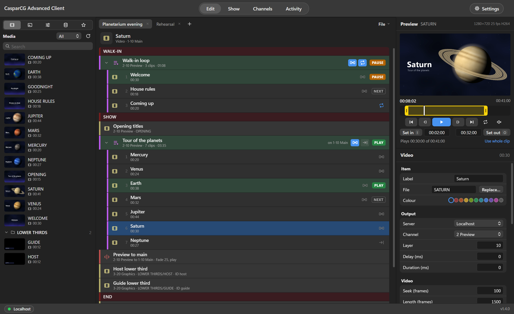
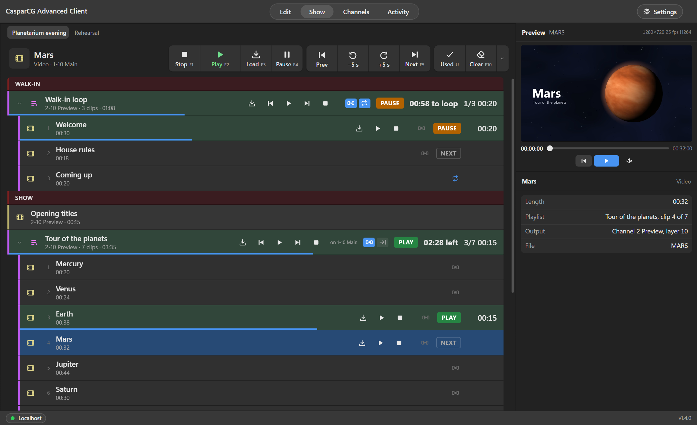
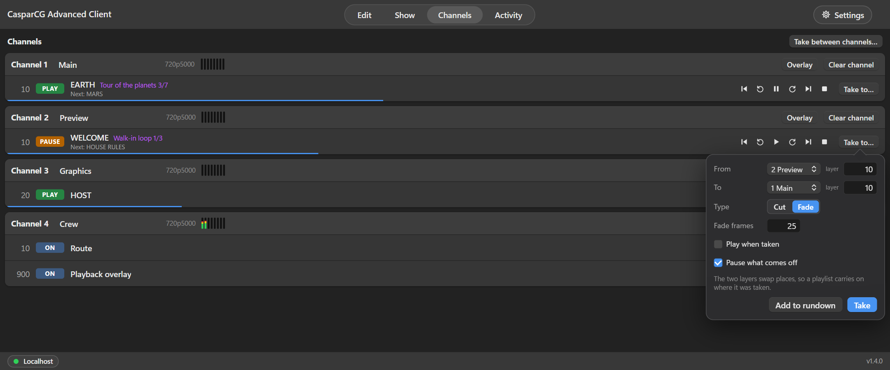
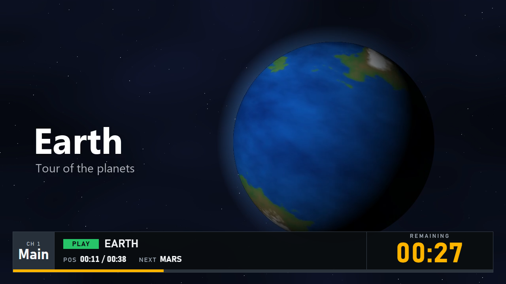
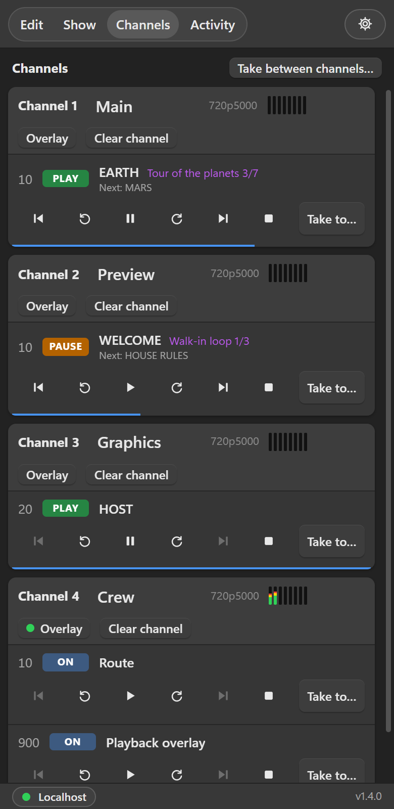

# CasparCG Advanced Client

A Windows client for CasparCG Server, for running video and graphics at events. It has playlists, takes between any two channels, and a preview that plays clips on your own PC. The server doesn't need any changes.

It has the same tools, shortcuts and rundown files as the original CasparCG Client. You can run it from the app, a browser, a phone on the same network, [Companion](https://github.com/internal-events-support/companion-module-neriftafu-casparcgadvancedclient), or [over HTTP and OSC](docs/remote-control.md).

**[Download the installer](https://github.com/internal-events-support/casparcg-advanced-client/releases/latest/download/CasparCG-Advanced-Client-Setup.exe)**

## Installing

You need:

- 64-bit Windows 10 or 11
- a CasparCG Server, on this PC or another one
- its media scanner running, for the list of clips and their thumbnails
- ffmpeg on this PC, but only for previewing clips

Run the installer. It doesn't need an administrator. Windows SmartScreen may warn you because the installer isn't code-signed. The app connects to a server on the same PC by itself. For any other, go to Settings → Servers.

If you have version 1.3.0 or earlier, run the installer once by hand, as those can't update themselves. Your settings are kept. If 1.3.0 was installed for all users of the PC, uninstall it first, and if you used the portable exe, delete it.

Up to 1.2.0 the app was called CasparCG Client. The new one copies your settings the first time it starts, but installs next to the old one, so quit and uninstall that.

### Updates

The app looks for updates when it starts and every six hours, but not while a playlist is playing. It downloads them in the background and installs them when you quit. To install one sooner, press Update in the top bar, and the app closes and reopens in about 10 seconds. Clips on air aren't touched.

It never updates by itself while it's running, or as it starts, so if you have to reopen it during a show you get the same version. You can turn automatic updates off in Settings → Updates.

## Using it

Build the show in Edit. Drag clips, templates and tools from the library on the left into the rundown, and set each one up on the right. Rundowns are saved as .xml files like the original client's, and either can open the other's. The original client sees a playlist as an auto play group and a take as a custom command.

Run it in Show, which has big buttons and the time left on everything, and where nothing can be changed by accident.

Quitting keeps the rundowns that are open, saved or not, and they're there next time.

### Playlists

Select some clips and press Ctrl+P. A playlist can loop or stop on its last clip, and either play the next clip by itself or hold until you press Next. Clips can cut or mix from one to the next.

You can edit a playlist while it's playing. It keeps going when it's taken to another channel, and if you have to restart the app it picks up where it was.

### Takes and channels

The Channels tab shows what's on every layer of every channel. You can play, pause, skip and stop each one from here, and give the channels names. No channel has a fixed role.

A take swaps any two layers on two channels of the same server, as a cut or a fade, and can start the clip as it goes. A playlist carries on where it was. Taking from an empty layer takes the other one off. Both channels have to be the same video format, and a fade needs the layer above to be free.

To have a take ready in the rundown, press Add to rundown or use the Channel Take tool.

### Previewing and trimming

Select a clip and press Space. It plays on this PC and sends nothing to the server, so it works with the server off. Set in and Set out (I and O) trim it.

Clips the app can't play directly, such as ProRes, DNxHD and MKV, get a small copy made first.

The preview has to be able to read the media folder. If the server is on this PC it's found automatically, and otherwise you choose it in Settings → Servers. ffmpeg is found if it's in the server's folder or on the PATH, and if not you can choose it in Settings → Playback.

### Missing clips

Clips that aren't on the server any more are marked Missing in the rundown. The app checks every 8 seconds, so you don't need to refresh.

Press Missing to pick a replacement. If a file was only renamed or moved, the app recognises it by its size and length and suggests the new name. Everything else about the entry stays the same, including its trim and remote ID.

### Copying settings

To give several entries the same settings, copy one with Ctrl+Shift+C, select the others and press Ctrl+Shift+V. It copies everything except the clip, label, remote ID and story ID.

### Shell commands

Shell Command entries run programs on this PC. They're off until you turn them on in Settings → Rundown, because a rundown from someone else could run anything.

## Playback overlay

The overlay shows the clip that's playing and the time left, drawn over a channel's picture by CasparCG. It's in everything that channel sends out, so put it on one that only the crew sees. It can show the clips from a different channel.

Press Overlay next to a channel in the Channels tab to set it up. When the time turns amber and red, and starts to flash, is in Settings → Remote Control.

## Browsers, phones and tablets

The whole client also works in a browser, with the same rundowns open. If people edit on several screens at once their changes are merged.

Settings → Web Interface has the addresses to open and the access code. Only this PC can use it until you turn on "Allow other devices" there.

Other devices can't change Shell Commands, choose programs or folders on the PC, or change the web interface's own settings. The connection isn't encrypted, so use it on a network you trust.

## Keyboard shortcuts

The playing keys are the same as in the original client. The full list is in Settings → Shortcuts.

| Keys | Does |
|---|---|
| F1 / F2 / F3 | Stop / play / load |
| F4 | Pause or resume |
| F5 / Shift+F5 | Next / previous clip in a playlist |
| F6 / F7 | Update / invoke a template |
| F8 | Preview |
| F10 / F11 / F12 | Clear / clear the layer / clear the channel |
| Space | Play or pause the preview |
| I / O | Set the in / out point |
| ← / → | Step the preview one frame (with Shift, ten) |
| Alt+← / Alt+→ | Back / forward on the server |
| Ctrl+E | Switch between Edit and Show |
| U | Mark as used or unused, in Show |
| Ctrl+P | Make a playlist |
| Ctrl+G / Ctrl+Shift+G | Group / ungroup |
| Ctrl+Shift+C / Ctrl+Shift+V | Copy / apply settings |
| Ctrl+Z / Ctrl+Y | Undo / redo |

## Development

Building from source, testing and cutting a release are in [docs/development.md](docs/development.md).
